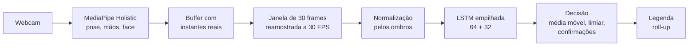
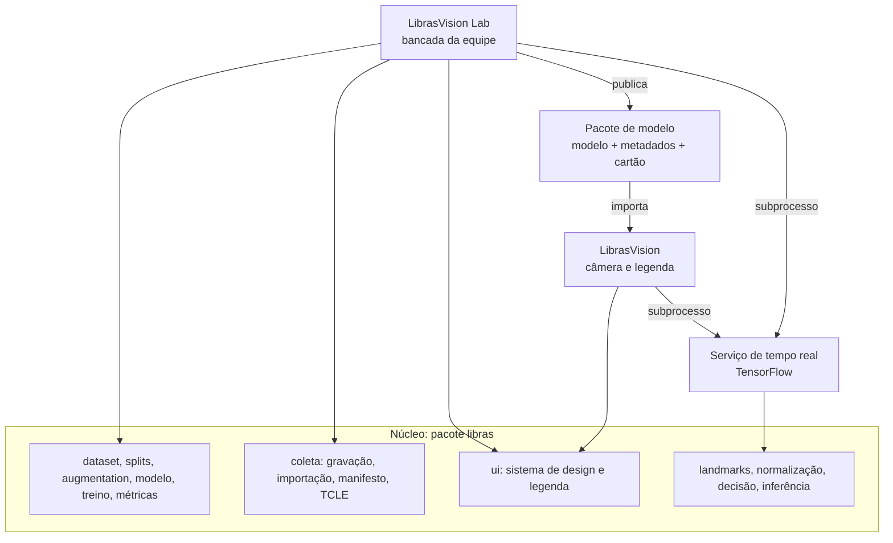

# LibrasVision

Reconhecimento de sinais dinâmicos da Libras por visão computacional, com tradução para texto em tempo real, em computador comum.

[](https://github.com/lorenzotoledo0/librasvision/actions/workflows/ci.yml)
[](LICENSE)
[](docs/adr/0001-python-3-11.md)
[](https://github.com/astral-sh/ruff)
[](docs/ROADMAP.md)

[English version](README.en.md)

## Sumário

- [Resumo](#resumo)
- [Demonstração](#demonstração)
- [Funcionalidades](#funcionalidades)
- [Como funciona](#como-funciona)
- [Arquitetura](#arquitetura)
- [Vocabulário](#vocabulário)
- [Instalação](#instalação)
- [Início rápido](#início-rápido)
- [Estrutura de dados](#estrutura-de-dados)
- [Metodologia de avaliação](#metodologia-de-avaliação)
- [Limitações e ética](#limitações-e-ética)
- [Roadmap](#roadmap)
- [Contribuir, citar e licença](#contribuir-citar-e-licença)
- [Equipe](#equipe)

## Resumo

**Problema.** Estudantes surdos enfrentam barreiras de comunicação no ambiente acadêmico. Faltam tradutores e intérpretes de Libras e Língua Portuguesa (TILSP) para situações cotidianas, como pedir informação na biblioteca ou na secretaria.

**Solução.** O LibrasVision reconhece sinais dinâmicos da Libras com uma webcam e mostra a palavra como legenda em tempo real. Ele extrai landmarks de mãos, corpo e rosto com o MediaPipe Holistic e classifica a sequência com uma rede LSTM. O sistema roda em CPU, com alvo em um Intel i5 com 4 GB de RAM.

**Para quem.** Para estudantes e servidores surdos e ouvintes em ambientes educacionais, como apoio pontual. **Não substitui um intérprete de Libras.** O projeto é um Trabalho de Conclusão de Curso (TCC II) de Ciência da Computação no Centro Universitário do Distrito Federal (UDF).

## Demonstração

> Ainda não há demonstração gravada: não existem vídeos reais nem modelo treinado.

Quando houver um modelo publicado, a demonstração ficará em `docs/img/demo.gif`. Para gerar:

1. Abra o app LibrasVision com um pacote de modelo publicado.
2. Grave a tela por 10 a 15 s com uma pessoa que autorizou o uso de imagem no TCLE (por exemplo, com a Ferramenta de Captura do Windows ou o OBS).
3. Converta para GIF com até 800 px de largura e até 5 MB (por exemplo, `ffmpeg -i demo.mp4 -vf "fps=12,scale=800:-1" docs/img/demo.gif`).

## Funcionalidades

| Funcionalidade | Situação |
|---|---|
| Extração de landmarks com MediaPipe Holistic (pose, mãos e face) | Implementado |
| Normalização única para treino, avaliação e tempo real | Implementado |
| Cadastro de sinalizadores com TCLE obrigatório e remoção LGPD | Implementado |
| Gravação pela webcam (take único e rajada com extração no fim) | Implementado |
| Importação de vídeos já gravados, com validação e deduplicação | Implementado |
| Revisão de takes com editor de corte | Implementado |
| Vocabulário configurável sem mudar código | Implementado |
| Data augmentation em landmarks (espacial, temporal, ruído) e em vídeo | Implementado |
| Treino da LSTM com validação cruzada por sinalizador | Implementado |
| Ablação com teste estatístico e testes de robustez | Implementado |
| App do usuário final com legenda roll-up e tema escuro | Implementado |
| Pacote de modelo publicado com verificação de integridade | Implementado |
| Coleta de vídeos reais | Em andamento |
| Resultados de acurácia e latência | A ser medido |
| Medição no hardware alvo (i5, 4 GB) | Planejado |
| Distribuição do app (instalador) | Planejado |
| Versão mobile | Planejado, nada decidido |

## Como funciona



1. **Captura:** cada frame da webcam é guardado com o instante real de chegada.
2. **Landmarks:** o MediaPipe Holistic detecta 33 pontos de pose, 21 de cada mão e 468 do rosto. O modelo usa um subconjunto de 96 pontos do rosto, num vetor de 550 valores por frame.
3. **Janela temporal:** os últimos frames são reamostrados para 30 FPS, então cada janela equivale a 1 s, mesmo que a webcam entregue menos quadros.
4. **Normalização:** origem no centro dos ombros e escala pela largura dos ombros. Distância da câmera e resolução deixam de importar.
5. **Classificação:** uma LSTM empilhada gera a probabilidade de cada classe, incluindo `nenhum_sinal`.
6. **Decisão:** média móvel das últimas predições, limiar de confiança e confirmações seguidas evitam que a legenda pisque.
7. **Legenda:** a palavra confirmada entra na legenda roll-up, desenhada pela interface.

Detalhes em [docs/MODEL.md](docs/MODEL.md).

## Arquitetura



- **LibrasVision Lab** (`libras.app`): bancada da equipe com coleta, revisão, dataset, treino, resultados e teste ao vivo.
- **LibrasVision** (`libras.app_real`): apenas câmera e legenda, com posição configurável (embaixo, sobre a pessoa ou faixa no alto), tema escuro e três faixas de largura preparadas para mobile.
- A interface nunca importa TensorFlow: treino, ablação e tempo real rodam em subprocesso.

Detalhes em [docs/ARCHITECTURE.md](docs/ARCHITECTURE.md).

## Vocabulário

| Classe | Tipo |
|---|---|
| `biblioteca` | sinal |
| `prova` | sinal |
| `secretaria` | sinal |
| `nenhum_sinal` | rejeição: repouso, transições, movimentos sem sinal |

Para acrescentar um sinal, não é preciso mudar código:

```powershell
.venv\Scripts\python scripts\vocabulario.py adicionar "Sala de aula" --meta 10
```

Também dá para usar a aba **Vocabulário** da bancada ou o campo "Nova palavra" da aba Gravar. Depois, grave a palavra com pelo menos 2 sinalizadores e treine de novo. O vocabulário fica em `data/vocabulario.json`.

## Instalação

**Requisitos:** Python 3.11, cerca de 1 GB de disco para as dependências e uma webcam.

O Python 3.13 e o 3.14 não funcionam, porque TensorFlow e MediaPipe não publicam pacotes para eles (verificado em 2026-10-05; veja o [ADR 0001](docs/adr/0001-python-3-11.md)). O 3.11 pode ficar instalado ao lado de outras versões.

### Windows (PowerShell)

1. Instale o Python 3.11 ("Windows installer (64-bit)" em <https://www.python.org/downloads/windows/>), mantendo **py launcher** e **tcl/tk and IDLE**.
2. Clone e instale:

```powershell
git clone https://github.com/lorenzotoledo0/librasvision.git
cd librasvision
powershell -ExecutionPolicy Bypass -File .\scripts\setup_windows.ps1
```

O script cria o `.venv` com o Python 3.11, instala as dependências, roda o `pip check` e verifica o ambiente, incluindo a webcam. Para desenvolvimento, acrescente `-Dev`. Sem PowerShell, dê dois cliques em `instalar.bat`.

Instalação manual equivalente:

```powershell
py -3.11 -m venv .venv
.venv\Scripts\python -m pip install --upgrade pip
.venv\Scripts\python -m pip install -r requirements.txt
.venv\Scripts\python scripts\verificar_ambiente.py
```

### Linux e macOS

```bash
git clone https://github.com/lorenzotoledo0/librasvision.git
cd librasvision
bash scripts/setup_unix.sh
```

O Linux é usado em desenvolvimento e no CI. O macOS não é testado.

### Verificar a instalação

```powershell
.venv\Scripts\python scripts\verificar_ambiente.py
.venv\Scripts\python -m pytest -q
```

## Início rápido

### 1. Abrir a bancada

```powershell
.\LibrasVisionLab.bat
```

### 2. Cadastrar sinalizador e gravar

Na aba **Sinalizadores**, cadastre a pessoa com o TCLE assinado. Na aba **Gravar**: Espaço grava, Enter aceita, Esc descarta. Use **Gravar rajada** para várias repetições seguidas.

Pela linha de comando:

```powershell
.venv\Scripts\python scripts\sinalizadores.py cadastrar --mao direita --tcle 2026-10-10
```

### 3. Importar vídeos já gravados

```powershell
.venv\Scripts\python scripts\importar.py D:\videos --padrao projeto --simular
.venv\Scripts\python scripts\importar.py D:\videos --padrao projeto
```

### 4. Preparar o dataset

```powershell
.venv\Scripts\python scripts\extrair.py
.venv\Scripts\python scripts\validar_dados.py
.venv\Scripts\python scripts\gerar_splits.py
```

### 5. Data augmentation de vídeo (opcional, lento)

A augmentation em landmarks é aplicada durante o treino (`--aug`). As variantes de vídeo são geradas à parte:

```powershell
.venv\Scripts\python scripts\aumentar_videos.py --variantes escuro claro
```

### 6. Treinar e avaliar

Exige pelo menos 2 sinalizadores por classe. Com menos, use `--ensaio`: as saídas ficam marcadas e não valem como resultado.

```powershell
.venv\Scripts\python scripts\treinar.py --nome baseline --aug nenhuma
.venv\Scripts\python scripts\treinar.py --nome aug --aug espacial temporal ruido
.venv\Scripts\python scripts\ablacao.py
.venv\Scripts\python scripts\treinar.py --nome final --final
```

Os resultados ficam em `runs\<data>_<nome>\`.

### 7. Publicar o modelo e abrir o app do usuário final

Na bancada, aba **Resultados** > **Publicar modelo**. Depois:

```powershell
.\LibrasVision.bat
```

Todos os scripts têm `--help`. Guia completo em [docs/GETTING_STARTED.md](docs/GETTING_STARTED.md).

## Estrutura de dados

```text
data/                          fora do Git (dados de pessoas)
  raw_videos/<classe>/S01_001.mp4
  landmarks/<classe>/S01_<classe>_001.npz
  manifest.csv                 uma linha por vídeo
  sinalizadores.csv            só ID, mão dominante e data do TCLE
  vocabulario.json
  splits/<protocolo>.json
runs/                          execuções de treino, logs (fora do Git)
publicados/<id>/               pacotes de modelo para o app (fora do Git)
```

Convenções, protocolo de coleta e metas em [docs/DATASET.md](docs/DATASET.md) e [docs/protocolo_coleta.md](docs/protocolo_coleta.md).

## Metodologia de avaliação

- **Protocolo principal:** validação cruzada estratificada por classe e agrupada por sinalizador (`StratifiedGroupKFold`, 5 partições). Nenhuma pessoa aparece no treino e no teste da mesma partição.
- **Métricas:** F1 macro e acurácia por vídeo (principal) e por janela, matriz de confusão, robustez a oclusão, ruído e queda de FPS, e latência de ponta a ponta.
- **Escolhas pela validação, nunca pelo teste.** Augmentation só no treino.
- **Comparações:** teste t corrigido para validação cruzada repetida, com correção de Holm.

| Métrica | Resultado |
|---|---|
| F1 macro por vídeo (protocolo principal) | a ser medido |
| Acurácia por vídeo (protocolo principal) | a ser medido |
| Latência de ponta a ponta, p95 (i5, 4 GB) | a ser medido |

O resultado do TCC I (97%) veio de um protótipo descartado e de uma avaliação que provavelmente não separava sinalizadores. Ele não é baseline deste sistema. Detalhes em [docs/EVALUATION.md](docs/EVALUATION.md).

## Limitações e ética

- **Não substitui um intérprete de Libras.** Reconhece apenas sinais isolados do vocabulário do modelo, sem frases, gramática ou contexto.
- **Vocabulário pequeno:** 3 sinais e a classe de rejeição na versão inicial.
- **Poucos sinalizadores:** a meta é de mais de 10 pessoas. Variações regionais, de idade e de estilo podem não estar representadas, o que pode enviesar o modelo.
- **Uma pessoa por vez:** o Holistic detecta uma pessoa só.
- **Iluminação e enquadramento** afetam a detecção. O app orienta a pessoa, mas não corrige tudo.
- **LGPD:** vídeos são dados pessoais. O projeto exige TCLE, usa só IDs, mantém os dados fora do Git e oferece exclusão definitiva. Veja [docs/DATA_PRIVACY.md](docs/DATA_PRIVACY.md).
- **Validação com a comunidade surda:** o vocabulário e os sinais precisam ser validados com pessoas surdas e intérpretes. Isso está no roadmap.

## Roadmap

- [x] v0.1.0: base do sistema (núcleo, bancada, app real, testes, documentação)
- [ ] v0.2.0: coleta e dataset (TCLE final, validação com a comunidade surda, mais de 10 sinalizadores)
- [ ] v0.3.0: modelo (baseline, ablação, robustez, resultados)
- [ ] v0.4.0: app real (medição no i5, distribuição, estudo para mobile, demonstração)
- [ ] v1.0.0: entrega do TCC

Detalhes em [docs/ROADMAP.md](docs/ROADMAP.md), nas [issues](https://github.com/lorenzotoledo0/librasvision/issues) e nos [milestones](https://github.com/lorenzotoledo0/librasvision/milestones).

## Contribuir, citar e licença

- **Contribuir:** leia o [CONTRIBUTING.md](CONTRIBUTING.md) e o [Código de Conduta](CODE_OF_CONDUCT.md). Dados de pessoas nunca são aceitos por PR.
- **Segurança e privacidade:** [SECURITY.md](SECURITY.md). **Suporte:** [SUPPORT.md](SUPPORT.md).
- **Citar:** use os metadados de [CITATION.cff](CITATION.cff) (botão "Cite this repository" no GitHub).
- **Licença:** [MIT](LICENSE).
- **Mudanças:** [CHANGELOG.md](CHANGELOG.md).

## Equipe

**Autores:** Augusto Cezar Araujo Saboia, Elizeu Barbosa Souza, Lucas Caitano Barreto e Lorenzo Toledo.

**Orientação:** Prof.ª Kadidja Valéria Reginaldo de Oliveira (TCC II), Curso de Ciência da Computação. No TCC I: Prof.ª Dra. Flavia Maria.

**Instituição:** Centro Universitário do Distrito Federal (UDF), Brasília-DF.

**Agradecimentos:** às pessoas sinalizadoras que participarem da coleta e à comunidade surda e aos intérpretes de Libras que contribuírem com a validação. [PLACEHOLDER: agradecimentos nominais, se a equipe quiser.]
