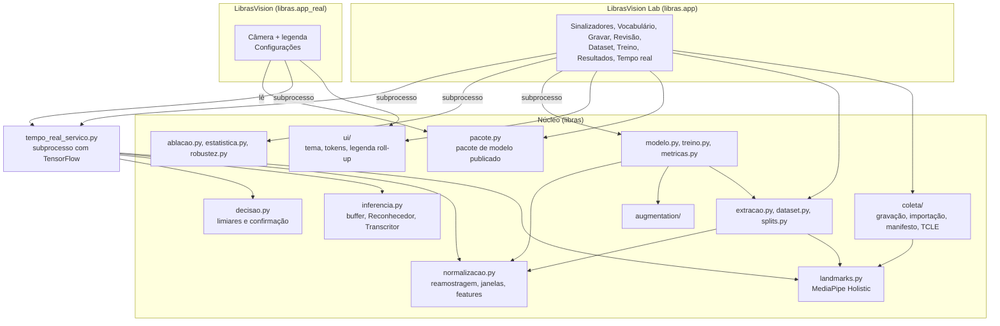
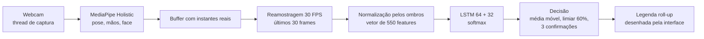
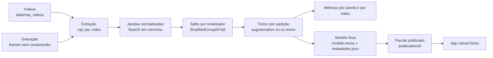

# Arquitetura

O LibrasVision é um pacote Python (`libras`) com um núcleo sem interface e dois aplicativos PySide6 em cima dele. As decisões estão em [decisoes.md](decisoes.md) e em [adr/](adr/README.md).

## Visão geral



## Pipeline em tempo real



O processamento roda num subprocesso (`libras.tempo_real_servico`): uma thread captura, outra roda MediaPipe e modelo sobre o frame mais recente, e frames que chegam durante o processamento são descartados. O serviço envia à interface, pela saída padrão, mensagens binárias (cabeçalho `LVQ1`, JSON com resultado e medições, e JPEG do frame) e recebe comandos pela entrada padrão.

## Pipeline de treino



## Regras de arquitetura

| Regra | Como é garantida |
|---|---|
| Uma única normalização para treino, avaliação e tempo real | módulo único e teste de igualdade entre as trajetórias |
| O processo da interface nunca importa TensorFlow | treino, ablação e tempo real em subprocesso; teste de arquitetura |
| O app real não importa coleta, treino nem augmentation | teste de arquitetura (`tests/test_arquitetura_app_real.py`) |
| Nenhuma tarefa longa na thread da interface | `Tarefa` (QThread) e `Subprocesso` (QProcess) em `ui/componentes.py` |
| Parâmetros do tempo real vêm do modelo, não do config atual | `metadados.json` do modelo |
| Cores e medidas visuais vêm de tokens | `ui/tokens.json`; teste falha com cor hexadecimal solta |
| Câmera e arquivos são fechados antes de reabrir | encerramentos em segundo plano esperados antes da reabertura |

## Organização do código

```text
src/libras/
  config.py, config_real.py   configuração (config.yaml + local.yaml; app_real.yaml)
  landmarks.py                extração com MediaPipe Holistic (módulo único)
  normalizacao.py             reamostragem, janelas, normalização e features (módulo único)
  decisao.py                  constantes e etapas da decisão em tempo real
  inferencia.py               buffer, reconhecimento e transcrição (sem interface)
  tempo_real_servico.py       subprocesso de tempo real
  extracao.py, dataset.py     extração em lote com cache; janelas e tf.data
  splits.py, selecao.py       divisões por sinalizador; seleção de classes do treino
  modelo.py, treino.py        LSTM, treino por partição, modelo final
  metricas.py, estatistica.py métricas e testes estatísticos
  ablacao.py, robustez.py     ablação e robustez
  relatorio_ablacao.py        tabelas LaTeX/CSV e figuras
  pacote.py, publicacao.py    pacote de modelo para o app real
  augmentation/               transformações em landmarks e em vídeo
  coleta/                     gravação, importação, cortes, manifesto, cadastro, qualidade
  app/                        LibrasVision Lab (bancada)
  app_real/                   LibrasVision (usuário final)
  ui/                         sistema de design, componentes, legenda, ícones
scripts/                      linha de comando
tests/                        testes com dados sintéticos
configs/                      config.yaml (documentado) e app_real.yaml
```

## Preparação para mobile

Nada está decidido sobre a plataforma mobile. O desenho atual reduz o custo de uma futura versão:

- três faixas de largura (compacta até 600 px, média e expandida), testadas;
- alvos de toque de 44 px;
- a lógica da legenda (`RollUp`) é pura e testada com relógio simulado, independente do Qt;
- o app real consome um pacote de modelo autocontido (`modelo.keras`, `metadados.json`, `cartao.json`), candidato a conversão para TensorFlow Lite.
